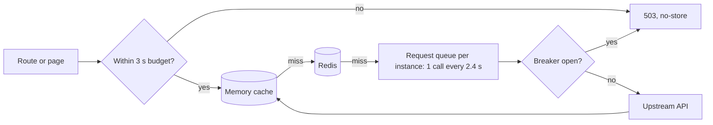

# Live sports data site: engineering case study

A client's sports site: fixtures, live scores, standings, team and player pages, news and a UFC section. Next.js 14 and TypeScript, deployed on serverless functions. The source is private; this page explains how the data layer works and what was measured.

## The problem

The site reads from free and low-tier sports APIs. One of them, TheSportsDB, allows about 30 requests a minute for the whole site. A busy match day turns every page view into a burst of upstream calls, and when the upstream stops answering, a serverless route that waits on it hangs until the platform kills it. The reader gets a gateway timeout and an empty page.

## How the data layer handles it

- **Two cache tiers.** An in-process cache in front of Upstash Redis, with stale-while-revalidate: a reader gets the cached answer at once and the refresh happens in the background. Stale data is served for up to 24 hours when the upstream is down.
- **A queue for the strict provider.** Within each server instance, TheSportsDB calls are serialised 2,400 ms apart (25 a minute, under the provider's limit). The queue lives in process memory, so several serverless instances each keep their own pace; it is not a site-wide ceiling. A 429 pauses calls for 30 seconds.
- **A circuit breaker per operation.** Five 429s in a row open the breaker for a minute. It used to be keyed on the full URL, so `lookupleague.php?id=4328` and `?id=4335` counted separately and the breaker never tripped. It is now keyed on the operation, and a test locks that in.
- **A time budget per route.** A route makes one blocking upstream call inside a 3-second budget and reads anything optional only if it is already cached. If the budget runs out it answers `503` with `Cache-Control: no-store`, so a failure is never cached as if it were real data.
- **Contract tests on provider shapes.** Recorded provider responses are checked against Zod schemas in tests, so a change in a provider's response shape fails a test.

## What was measured

One route, `/api/spotlight`, during a full upstream outage (recorded in the project's QA log, 10 Oct 2026):

| Version | Time to answer |
|---|---|
| Three cached calls, no budget | 19,236 ms |
| One call inside the 3 s budget | 3,006 ms, `503` + `no-store` |

## Tests

462 Vitest tests in 73 files, all passing (run on 13 Nov 2026 at commit `ca08546`). They cover the rate limiter, the circuit-breaker key, admin authentication, log redaction, and network-level fakes with MSW.

## Stack

TypeScript, Next.js 14 (App Router), React, Tailwind CSS, Radix UI, Zod, Upstash Redis, Vitest, MSW.
